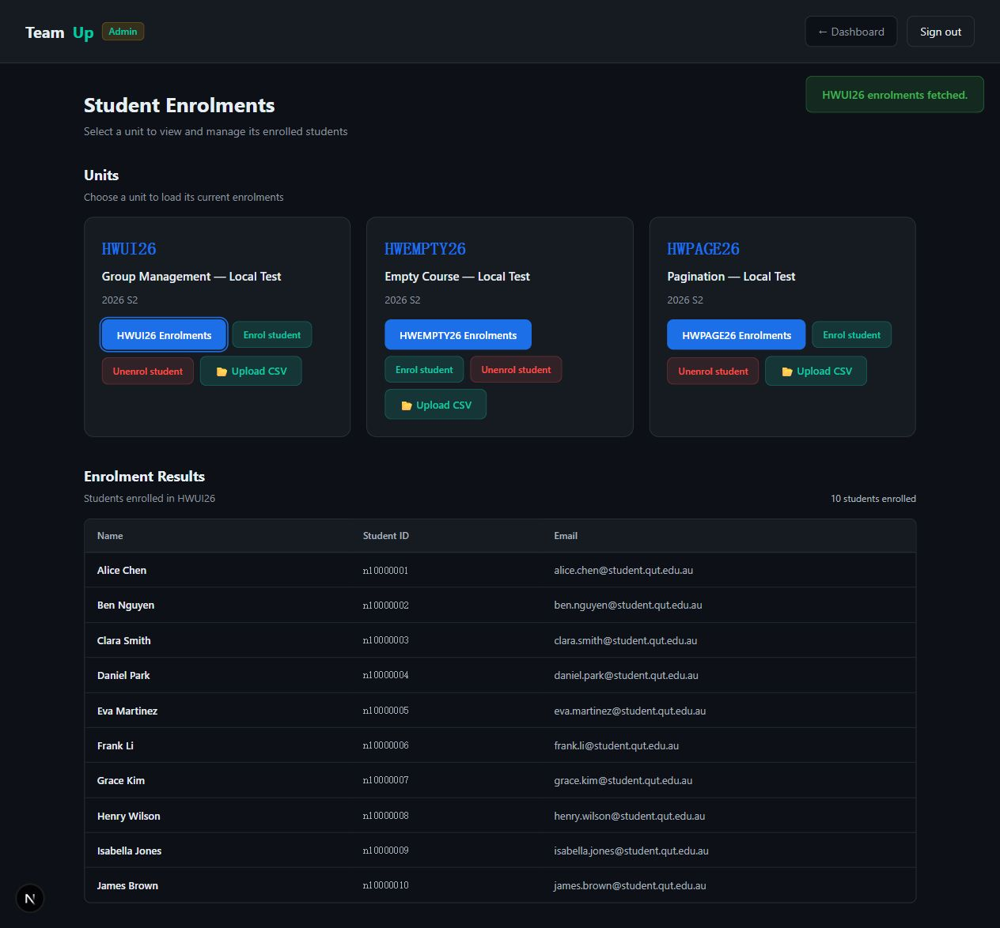
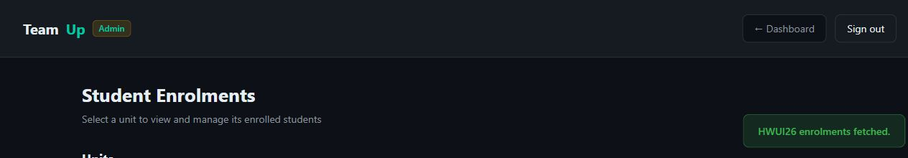

# TeamUp user guide

Last updated: 1 October 2026

This guide covers the main student and administrator workflows used during
assessment testing. Use the demo accounts and password listed in `README.md`.

## Student workflow

### Dashboard and TeamUp ID

1. Sign in with a student number and open the Dashboard.
2. The **Your TeamUp ID** panel near the top of the Dashboard displays the
   student's invitation ID. TeamUp IDs use the format `TU-XXXXXX` and are the
   identifiers group creators enter when sending an invitation.
3. Select **Copy ID** to copy the TeamUp ID, then share it with classmates who
   need to send an invitation. A TeamUp ID is different from a student number.
4. Use **Edit Availability & Profile** to keep tutorial availability and contact
   details current. Shared tutorial availability is required before a group can
   be locked.

If the Dashboard says that student and group information could not be loaded,
ask an administrator to confirm that the account is enrolled in a unit, then
sign in again.

### Student Directory

Open the Directory with any of these routes:

- Select **Open directory** near the top of the Dashboard.
- Select **Browse students** in the Group actions panel.
- Select an **Available place** in the Group members section.

The Directory only displays classmates from the signed-in student's unit.
Use search to find a name, student number, TeamUp ID or email address. The
filters narrow the list by group status, student type, cohort and tutorial
availability. Sorting and page-size controls help with large classes.

Select the profile button on a row to view that student's public profile. A
group creator can send an invitation from the Directory when the classmate is
available and the group is still forming.

### Group invitations

Pending invitations appear on the Dashboard. Select **Accept** to join the
group or **Decline** to dismiss the invitation. Group creators can invite a
classmate by entering the classmate's TeamUp ID in the Group actions panel. Do
not enter a QUT student number in this field.

Empty places are buttons, not inactive placeholders. Selecting one opens the
Student Directory so the creator can look for a suitable classmate. Empty
places are not displayed after the group is locked.

## Administrator workflow

### Units and tutorial timeslots

Create a unit from **Unit Management** on the Admin Dashboard. Unit codes must
be unique, for example `IFB398`.

Tutorial timeslots are added from a unit's edit page. Use the format shown by
the form: `DAY-HH:MM`, for example `MON-09:00`. Select **Add timeslot** to add
the value to the on-screen list, then select **Save timeslot changes** to write
the complete list to the database. Adding a timeslot to the list alone does not
save it.

### Student enrolments

Open **Student Enrolments** from the Admin Dashboard and select the unit's
**Enrolments** button. The **Enrolment Results** table shows **Name**, **Student
ID** and **Email**, with the total number of enrolled students above it. On a
narrow screen, scroll sideways within the table to view all columns.

**No enrolments selected** means a unit has not been selected yet. **No students
are enrolled in [unit code]** means the selected unit has no enrolled students.



The screenshot uses a local test unit; choose the relevant unit in your own
installation.

Use the following actions on the unit card:

- **Enrol student** for one student.
- **Unenrol student** to remove an existing enrolment.
- **Upload CSV** for a list of student numbers.

The single-student forms require a student number, name and email that match an
existing account. For removal, use the details in **Enrolment Results**. For
addition, obtain the existing account details from the administrator.

If **Student not found.** appears, check all three fields. If the student is
already enrolled, confirm their current unit assignment with the administrator.

After submitting, select **Back to enrolments** and reload the unit's list to
check the result. **Cancel** returns without submitting the form.

Temporary notifications appear below the navigation and disappear after a few
seconds. Navigation buttons remain accessible while a notification is shown.



For CSV upload, check the **Unit** selection on the upload page before
submitting. The CSV must contain one student number per line, using existing
student accounts. It may start with the header `student_id`:

```csv
student_id
n10000001
n10000002
```

An [example CSV](testing/fixtures/enrolment-example.csv) is included. Check that
its demo student numbers exist in your installation before using it.

After upload, review the summary for successfully enrolled, already enrolled
and unknown student numbers. Return to **Student Enrolments** and reload the
selected unit's list to check the result.

### Groups and exports

Use **Manage Groups** to select a unit, view group members and unlock a locked
group when corrections are required. Use **Export CSV**, select a unit, then
select **Download CSV** to download current unit, student and group data.

The export includes student numbers, full names, emails, cohorts, new/returning
status, group details, shared tutorial slots and constraint results. Names are
stored in one column. Students without a group are marked `NO_GROUP`. For an
enrolment upload, copy only the student numbers into the format shown above.

## Setup and troubleshooting

- Keep the repository in a normal local folder while running data setup. A
  OneDrive-synchronised project folder can lock or duplicate files during data
  seeding.
- `npm run lrgDataSeed` resets the configured TeamUp database. Do not run it
  against shared or valuable data without a backup and team agreement.
- If a page reports that no unit or enrolment is available, confirm the account
  and unit assignment before treating it as a UI problem.
- If the Directory is empty, clear its filters and confirm that the signed-in
  student and the expected classmates are enrolled in the same unit.
- For admin page testing, check a populated unit and an empty unit. Confirm the
  student count and empty message, then check that notifications leave the
  navigation accessible and the table can be scrolled on a narrow screen.
- If CSV upload fails, check the unit's current enrolments and report the
  problem to the team. Use **Enrol student** for individual changes.
